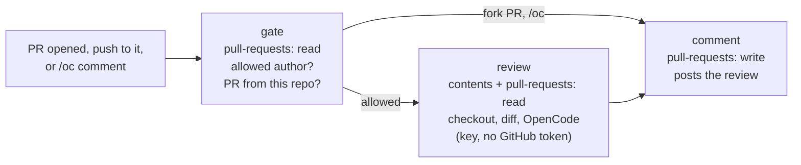

# workflows

Reusable GitHub Actions workflows for yetibyte repositories, public and private. Call them
with `workflow_call`, pinned to a full commit SHA with the tag in a comment (AGENTS.md §3).

| Workflow | What it does |
| --- | --- |
| [`opencode-review.yml`](.github/workflows/opencode-review.yml) | AI review of pull requests with OpenCode, posted as a PR comment; `/oc` comments ask again |

This repository is public because a public repository can't call a private repository's
workflows. Nothing in it is secret: callers pass their own keys.

## opencode-review

Reviews each pull request that an allowed author (the repository owner by default) opens from
a branch of the repository, and posts the review as a comment. It's not a required check.
Each push to the PR gets a review too, of the new commits: it says which earlier findings
they resolve and names the ones still open. A comment `/oc` or `/oc <request>` on a PR asks
again, with the comment as the request: a follow-up question, a second look, or a debate
about a finding. The reviewer sees the PR's earlier comments, reviews and inline comments, so
it doesn't repeat what was already answered. Each review names the commit it reviewed.

Reviews of pushes cost a model call each. A newer push cancels a review that's still running.
To turn them off, set `review-pushes: false`, or leave `synchronize` out of the caller's
trigger types, which saves the skipped runs too.

### Usage

```yaml
# .github/workflows/ai-review.yml
name: ai-review

on:
  pull_request:
    types: [opened, synchronize, reopened, ready_for_review]
  issue_comment:
    types: [created]

permissions: {}

jobs:
  review:
    uses: Yeti47/workflows/.github/workflows/opencode-review.yml@<commit-sha> # v1.1.0
    # the most any job of the review may have; only its comment job writes
    permissions:
      contents: read
      pull-requests: write
    secrets:
      api-key: ${{ secrets.OPENCODE_REVIEW_API_KEY }}
```

Then:

1. Create a dedicated API key for the model provider (an OpenCode Go key for the default
   model), so it can be revoked on its own, and store it as the repository secret
   `OPENCODE_REVIEW_API_KEY`. Pass it explicitly as above, not with `secrets: inherit`.
2. Optionally add `.github/ai-review.md`: what the repository is, and what the reviewer
   should check first (see [the guide](#the-guide)).

`/oc` comments run the caller workflow from the default branch, so they only work once it's
merged there.

### Inputs

| Input | Default | Meaning |
| --- | --- | --- |
| `model` | `opencode-go/glm-5.3-flash` | OpenCode model (`provider/model`) that writes the review |
| `opencode-version` | `2.3.2` | OpenCode v2 release to run; change `opencode-sha256` with it |
| `opencode-sha256` | digest of 2.3.2 | sha256 of the release's `opencode-linux-x64.tar.gz` |
| `review-pushes` | `true` | review again after each push to the PR, focused on the new commits; needs `synchronize` in the caller's trigger types |
| `command` | `/oc` | comment prefix that asks for a review |
| `allowed-associations` | `["OWNER"]` | JSON array of author associations that may trigger a review; in an organization's repository, people are `MEMBER`, never `OWNER` |
| `guide-path` | `.github/ai-review.md` | the reviewer's guide, read from the PR's base branch; optional |
| `max-diff-bytes` | `2097152` | the attached diff is cut at this size, and the model told where |
| `max-conversation-bytes` | `204800` | earlier comments are cut to their latest this many bytes |

| Secret | Meaning |
| --- | --- |
| `api-key` (required) | the model provider's key, given to OpenCode as `OPENCODE_API_KEY` |

### How it works



- **gate** runs only for allowed authors: their non-draft PRs from a branch of the
  repository (opened, reopened, ready for review, or pushed to), and their `/oc` comments on
  PRs. Comment events run with secrets and don't say
  where the PR comes from, so the gate asks the API before anything is checked out. A fork's
  code never meets the key; for an `/oc` on a fork's PR the comment job says so instead of
  reviewing.
- **review** checks out the PR's latest commit with a read-only token and no stored
  credentials. It collects the diff against the base branch, the commit log and the PR's
  earlier conversation into files. After a push it adds the commits since the last review,
  with their log and their diff from the reviewed commit. After a force push there are no
  such commits, and the model is told so. The reviewed commit comes from a hidden marker in
  the newest review comment, not from the push event, so commits whose review a newer push
  cancelled still count as new. If there's no earlier review, the whole change is reviewed.
  They're files because the agent has no shell (git, for one, reads files outside the repository).
  OpenCode is a pinned release, checksum-verified, not installed with
  `curl | bash`. The step that runs it gets the model key and no GitHub token, and the review
  is checked for the key before it's posted.
- **comment** is the only job that can write, and only comments.

The reviewer is a read-only OpenCode agent that is part of this workflow: it may only read,
glob and grep inside the repository (no absolute paths, no `.git/`, no `.env` files). The
checkout's own OpenCode config (`.opencode/`, with agents and plugins, and
`opencode.json(c)`) is removed before OpenCode starts, so a pull request can't change its
reviewer's permissions or run code next to the key. Symlinks are removed too, because
OpenCode checks paths by their text. OpenCode still reads the checkout's instruction files,
such as `AGENTS.md`; only people with push access can trigger a review, and they control the
caller workflow anyway.

Runs are skipped for anything else (other comments, drafts, other authors), and a newer
request for the same PR cancels a running review.

### The guide

The generic reviewer checks for bugs, security, the repository's documented conventions,
missing tests and stale docs, in that order. A guide adds what's specific to the repository:

```markdown
Acme: a .NET server (`src/Acme.Server`) and an Angular app (`src/Acme.Web`). The
conventions are in `AGENTS.md`.

Check in particular:

- Security: every endpoint is authorized, and users see only their own data.
- CI checks formatting (CSharpier, Prettier), the build and the tests.
```

It's appended to the agent's instructions, so it's read from the PR's base branch, never the
PR's own: a pull request can't steer its own review, and a changed guide takes effect once
merged. Leave out a top-level heading; the workflow puts it under "About this repository".

### Updating OpenCode

Pick the release from all tags, not just GitHub's "latest release": OpenCode publishes v1
maintenance releases too, and this workflow needs v2. Take the asset's digest from the
release:

```sh
gh api repos/anomalyco/opencode/releases/tags/v<version> \
  --jq '.assets[] | select(.name == "opencode-linux-x64.tar.gz") | .digest'
```

## Versioning

Changes go through pull requests, which review themselves with the PR's own version of
`opencode-review.yml` ([`ai-review.yml`](.github/workflows/ai-review.yml)) and are checked by
actionlint and gitleaks. Releases are tags: `v1.x.y` for compatible changes, `v2.0.0` when an
input, secret or output changes incompatibly. Callers pin the tag's commit SHA:

```sh
gh api repos/Yeti47/workflows/commits/v1.0.0 --jq .sha
```

Dependabot's `github-actions` ecosystem updates such pins in calling repositories.

## Secret scanning

[`gitleaks.yml`](.github/workflows/gitleaks.yml) scans the full history on every push and
pull request; locally, the [pre-commit](https://pre-commit.com) hook in
`.pre-commit-config.yaml` scans staged changes:

```sh
gitleaks git --pre-commit --redact --staged --verbose
```

## License

[MIT](LICENSE)
